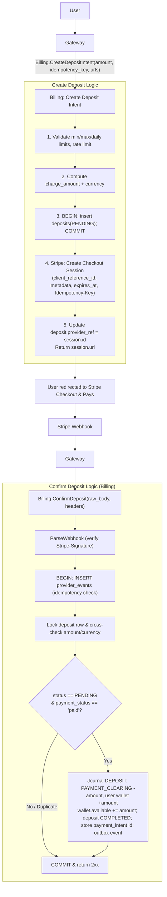
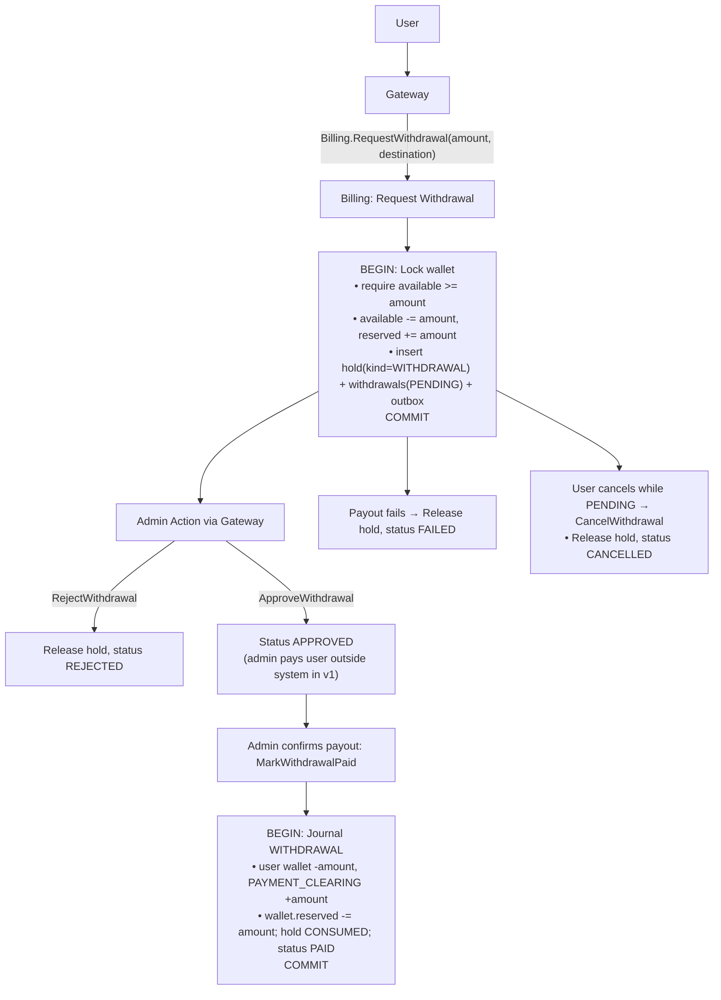

# 06 – Deposits and Withdrawals (Stripe)

Deposits use **Stripe Checkout** (hosted payment page) with **webhooks** as the only thing that credits a wallet. Everything sits behind a `PaymentProvider` interface so CI can use a mock and you can swap providers later.

```go
type PaymentProvider interface {
    Name() string
    CreateCheckout(ctx context.Context, in CheckoutInput) (CheckoutResult, error) // idempotency key, deposit id, amount, currency, URLs, expiry
    ParseWebhook(headers http.Header, body []byte) (WebhookEvent, error)         // verifies signature, normalises the event
    GetCheckoutStatus(ctx context.Context, ref string) (CheckoutStatus, error)   // used by reconciliation
}
```

Implementations: `stripe` (primary, test mode first) and `mock` (unit/integration tests and CI, no network).

## Stripe setup

| Item | Value |
|---|---|
| Mode | **Test mode** (sandbox) keys: `sk_test_...` |
| Env vars | `STRIPE_SECRET_KEY`, `STRIPE_WEBHOOK_SECRET`, `STRIPE_CURRENCY` (default `lkr`), `CREDITS_PER_USD` (only used when charging in USD) |
| Hosted page | Checkout Session, `mode=payment`, one line item "Wallet top-up" |
| Webhook endpoint | Gateway `POST /webhooks/stripe` (relayed to billing) |
| Local dev | Stripe CLI: `stripe listen --forward-to http://localhost:<gateway-port>/webhooks/stripe`; it prints the `whsec_...` secret to use locally |
| Test cards | `4242 4242 4242 4242` (success), `4000 0000 0000 9995` (declined, insufficient funds), `4000 0025 0000 3155` (3-D Secure) |

### Sri Lanka caveat (accepted for this project)

Stripe does not offer live accounts in Sri Lanka, but **test mode works from anywhere** with an account created in a supported country, so the sandbox plan is unaffected. Whether `lkr` is accepted as a charge currency on your test account is something to check in the Stripe dashboard/docs (I haven't verified it here). Fallback if it isn't:

- Charge in `usd` with a fixed demo rate: `charge_amount = ceil(credits / CREDITS_PER_USD)` in USD cents and store `fx_rate` on the deposit and keep it fixed per intent.
- Money amounts stay integers. The rate is only used once, at intent creation.
- When charging in LKR, `charge_amount == amount` numerically (both are 1/100 units), so no conversion exists.

## Deposit flow



Events handled:

| Stripe event | Action |
|---|---|
| `checkout.session.completed` | Credit if `payment_status = paid`. If still unpaid (async method) wait |
| `checkout.session.async_payment_succeeded` | Credit |
| `checkout.session.async_payment_failed` | Mark FAILED |
| `checkout.session.expired` | Mark EXPIRED |
| `charge.refunded`, `charge.dispute.created` | Dispute/refund handling below |

Ignore unknown event types with a 2xx so Stripe stops retrying.

### Rules that keep this safe

- **Only a verified webhook credits a wallet.** The success redirect is UI only.
- **Verify the signature against the exact raw bytes.** The gateway must pass the body untouched as `bytes` (no JSON parsing/re-encoding), together with the `Stripe-Signature` header. Billing holds the webhook secret.
- **Dedupe twice:** `provider_events` (event id) and the deposit status check. Duplicates and out-of-order events are harmless.
- **Credit `deposit.amount` (what was agreed at intent time)**, and only after the paid amount and currency match. A mismatch is not credited. It raises an alert for review.
- **Respond 2xx only after commit.** If the transaction fails, return a non-2xx so Stripe retries.
- **Late success after expiry:** the money was received, so credit it and flag for review.
- **Reconciliation worker:** every few minutes, for deposits PENDING past `expires_at` (or older than ~15 min), call `GetCheckoutStatus` and complete or expire them. This covers missed webhooks.
- **Idempotent creation:** the Stripe `Idempotency-Key` makes a retried `CreateDepositIntent` return the same Checkout Session, so a crash between steps 3 and 5 is recoverable (reconciler expires orphan PENDING rows).
- Limits: min deposit (above Stripe's minimum charge), max per deposit, max per day per user (config table).

## Refunds and disputes (manual, with alerts)

**NOTE**: These are nice to have features. Not necessary.

- `charge.dispute.created`: freeze the wallet, mark the deposit DISPUTED, page an admin. Resolution is a recorded `ADJUSTMENT` journal.
- `charge.refunded`: mark REFUNDED and debit the credits via `ADJUSTMENT` if still available; otherwise flag the shortfall for manual follow-up.
- Known limitation: if the user already spent the credits, the platform absorbs or recovers the loss manually. Automating clawbacks (negative balances/receivables) is out of scope for v1.

## Withdrawal flow (admin-approved)

**NOTE**: Admin realted logic are not planned or implemented. These are nice to have features.



- Funds are locked at request time, so users can't trade them away while the withdrawal is pending.
- The state machine is enforced in code and with `UPDATE ... WHERE status = 'PENDING'` guards, so double-clicks and retries are safe.
- Controls: minimum amount, daily limit, withdrawal only to a saved destination; optional flat withdrawal fee booked as an extra `PLATFORM_REVENUE` line in the payout journal.
- Destination details (bank account numbers) are sensitive: encrypt at rest (application-level AES-GCM, key from the secret store) and never log them.

### Why withdrawals stay manual in this plan.

Paying users out through Stripe needs **Stripe Connect** (connected accounts, transfers/payouts), which has its own country and onboarding requirements and is a broad feature for a demo. For the sandbox demo, `MarkWithdrawalPaid` simulates the payout. Later options: Connect transfers in test mode if the test account supports it, or refunds to the original card, limited to the amount actually deposited.

## Edge cases

| Case | Handling |
|---|---|
| Duplicate or out-of-order webhook | Event-id dedupe + status check so no double credit |
| Webhook arrives before the deposit row is visible | Return non-2xx and Stripe retries |
| Paid amount or currency differs from the intent | No credit and alert for manual review |
| Wallet FROZEN | Deposits still credit. Withdrawals and reservations blocked |
| Withdrawal amount > available (funds held for orders) | `INSUFFICIENT_FUNDS` and UI shows available vs reserved |
| Stripe API down at intent creation | Deposit stays PENDING without a ref so return `UNAVAILABLE` and eventually reconciler expires it |
