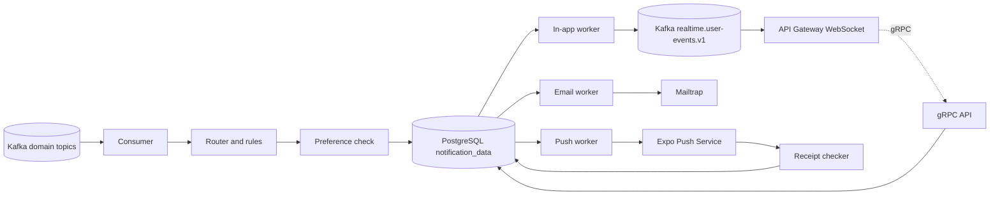

# Architecture

## 1. Components

The service is **one repository and one container image** that can run in three roles. In local development one process runs all three. In production each role can be scaled separately with the `SERVICE_ROLES` setting (e.g. `SERVICE_ROLES=consumer,worker`).

| Role | What it does |
|---|---|
| `api` | gRPC server for the API Gateway (inbox, preferences, push tokens, internal send) + Fastify HTTP for health, metrics and provider webhooks |
| `consumer` | Kafka consumer group `notification-service`. Turns domain events into notifications and delivery jobs |
| `worker` | Delivery workers per channel (`in_app`, `email`, `push`), the push receipt checker, and scheduled cleanup jobs |



## 2. Processing pipeline

For each Kafka record:

1. **Decode** the Protobuf message for the topic. If it cannot be decoded, send it to the dead-letter topic `notification.dlq.v1` and continue (a broken record must not block the partition).
2. **Route** to a handler by topic and event type. The handler returns zero or more **notification intents**: `{ userId, type, data, sourceEventId, dedupeKey }`.
3. **Resolve preferences** for each intent: which channels are enabled for this user and category.
4. **Rate-limit check** (Redis). If the user is over the limit for a channel, that channel is skipped or collapsed (see [10-reliability-security-observability.md](10-reliability-security-observability.md)).
5. **Write in one PostgreSQL transaction:**
   - insert into `notifications` (`ON CONFLICT (dedupe_key) DO NOTHING`),
   - insert one row into `notification_deliveries` per enabled channel with status `pending`.
6. **Commit the Kafka offset** only after the transaction commits.

Delivery workers then pick up `pending` rows and send them.

### Why a database-backed delivery queue

Industry practice is to avoid a **dual write** (writing to the database and to a queue as two separate steps, where one can succeed and the other fail). Options considered:

| Option | Pros | Cons |
|---|---|---|
| **PostgreSQL table + `SKIP LOCKED` (chosen)** | Notification and its jobs are created atomically. No extra infrastructure. Easy to query status. Scales to many workers | Polling adds a small delay (mitigated with `LISTEN/NOTIFY` wake-ups). Fine for our volume |
| BullMQ (Redis) | Mature retries, delays and dashboards | Dual write between Postgres and Redis. Redis is not configured for durable persistence in our infra |
| Kafka retry topics | Same broker as events | Complex retry topology. Hard to see the status of one notification |

If volume grows far beyond the project's needs, the delivery table can be replaced by a queue without changing handlers, because workers sit behind a `DeliveryQueue` interface.

### Worker loop

```sql
UPDATE notification_deliveries d
SET status = 'processing', locked_until = now() + interval '60 seconds', attempts = attempts + 1
WHERE d.id IN (
  SELECT id FROM notification_deliveries
  WHERE channel = $1
    AND status IN ('pending', 'retrying')
    AND next_attempt_at <= now()
  ORDER BY priority DESC, next_attempt_at
  LIMIT $2
  FOR UPDATE SKIP LOCKED
)
RETURNING d.*;
```

- The consumer runs `NOTIFY notification_deliveries` after commit so workers wake up immediately. Workers also poll every 1 s as a fallback.
- A job stuck in `processing` after `locked_until` (worker crashed) is picked up again by a reaper.
- On success: `status = 'sent'`, store the provider message ID.
- On temporary failure: `status = 'retrying'`, `next_attempt_at = now() + backoff(attempts)`.
- On permanent failure or max attempts: `status = 'failed'`, store the error code.

## 3. Delivery semantics

| Stage | Guarantee | How |
|---|---|---|
| Kafka to database | At-least-once, de-duplicated | Offset committed after the DB transaction. `dedupe_key` unique index |
| Database to provider | At-least-once | Worker retries. A crash after the provider accepted but before we saved `sent` can cause **one duplicate send**. We reduce this by passing our delivery ID as an idempotency key or custom header where the provider supports it |
| Real-time in-app | Best effort + resync | The inbox in PostgreSQL is the source of truth. Clients re-fetch the inbox and unread count after reconnecting |

## 4. Ordering

- Kafka guarantees order only within a partition. Producers key order events by `order_id` and trades by `trade_id`.
- Notifications do not need strict global order. The inbox is sorted by the event time (`occurred_at`), not by processing time.
- A late `order.partially_filled` after `order.filled` is still stored (it is a valid history item) but **push and email are skipped** if a newer terminal state for the same order already exists. This uses the `group_key` column (see [04-data-model.md](04-data-model.md)).

## 5. Dependencies and failure behaviour

| Dependency | If unavailable |
|---|---|
| Kafka | Consumer pauses and reconnects. Nothing is lost (events stay in Kafka) |
| PostgreSQL | Consumer stops committing offsets and pauses. Readiness turns false |
| Redis | Rate limiting **fails open** (sends allowed, warning logged). Unread count is read from PostgreSQL |
| Auth Service (`GetUser`) | Email jobs are retried later. In-app and push do not need contact data |
| Mailtrap | Email jobs retry with backoff. Other channels unaffected |
| Expo Push Service | Push jobs retry with backoff. Other channels unaffected |
